<h1 align="center">CineXplora</h1>

<p align="center">
  <b>Explora, descubre y haz seguimiento de películas y series.</b><br>
  App Android nativa con interfaz adaptada a vertical y horizontal, multiidioma y tema claro/oscuro.
</p>

<p align="center">
  
  
  
  
  
  
  
  
</p>

<p align="center">
  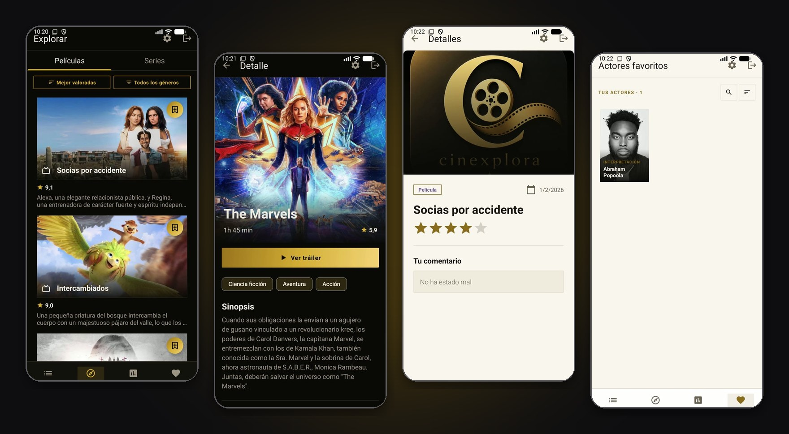
</p>

## Qué hace

| | |
|---|---|
| **Explorar** | Películas y series populares con filtrado por género y opciones de ordenación |
| **Pendientes** | Guarda películas y series para ver más tarde |
| **Seguimiento** | Registra lo que has visto con fecha, valoración personal y foto de recuerdo |
| **Actores favoritos** | Guarda actores y consulta su filmografía completa |
| **Búsqueda global** | Busca por título en películas y series |
| **Autenticación** | Email y contraseña o **Google Sign-In** (Firebase Authentication) |
| **Perfil** | Nombre, avatar, tema (claro/oscuro) e idioma (español/inglés) |
| **Detalle completo** | Sinopsis, reparto, equipo técnico, trailers, datos de producción y comentarios |

## Capturas

<table>
<tr><td align="center">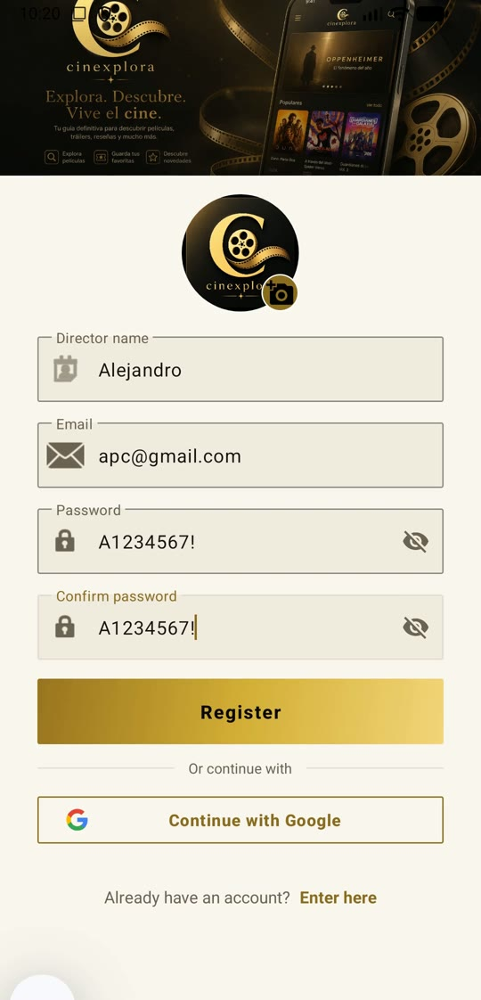<br><sub><b>Registro y acceso con Google</b></sub></td><td align="center">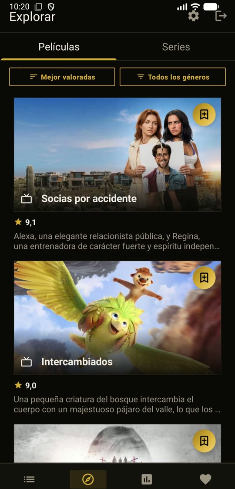<br><sub><b>Explorar películas (tema oscuro)</b></sub></td><td align="center">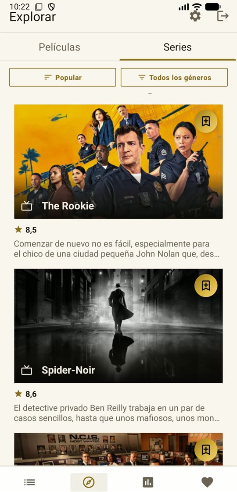<br><sub><b>Explorar series (tema claro)</b></sub></td></tr>
<tr><td align="center">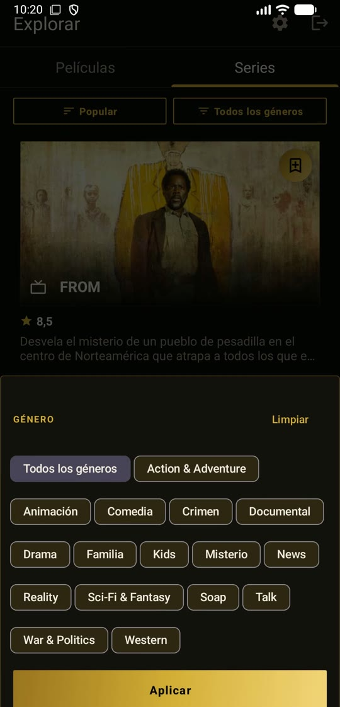<br><sub><b>Filtro por género</b></sub></td><td align="center">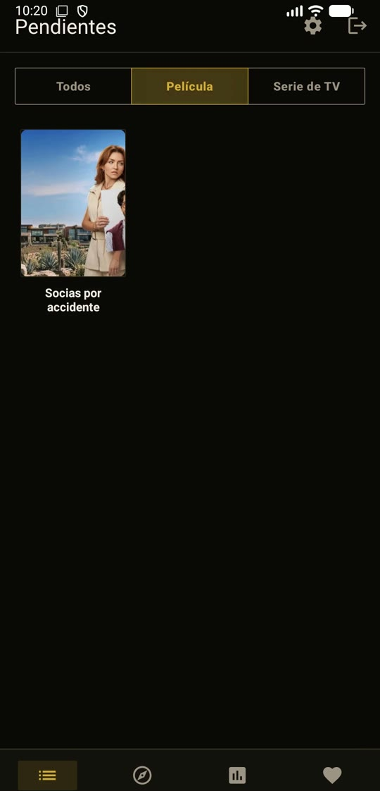<br><sub><b>Lista de pendientes</b></sub></td><td align="center">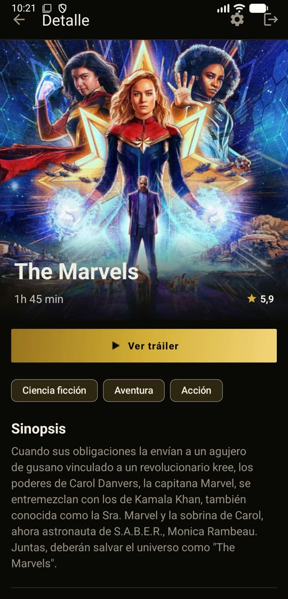<br><sub><b>Detalle con tráiler y géneros</b></sub></td></tr>
<tr><td align="center">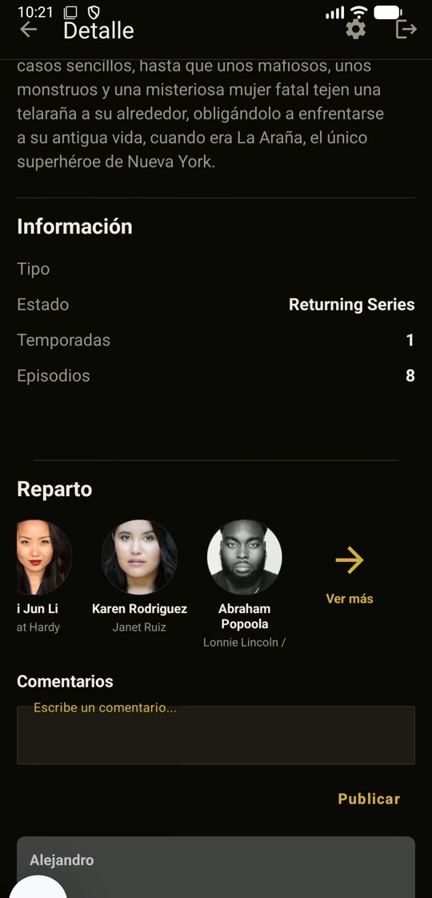<br><sub><b>Reparto y comentarios</b></sub></td><td align="center">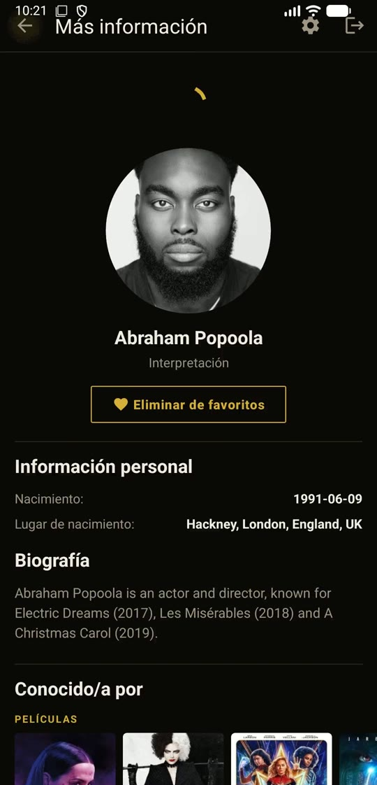<br><sub><b>Ficha de actor</b></sub></td><td align="center">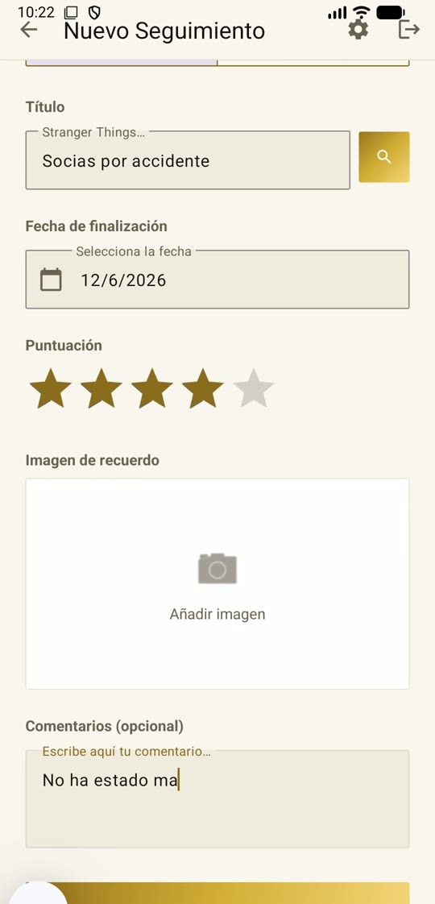<br><sub><b>Nuevo seguimiento</b></sub></td></tr>
<tr><td align="center">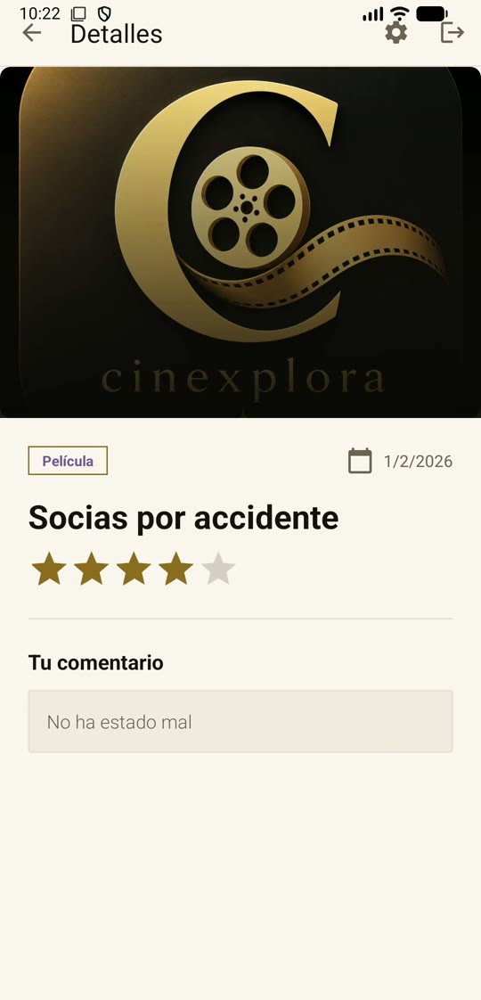<br><sub><b>Seguimiento: nota y comentario</b></sub></td><td align="center">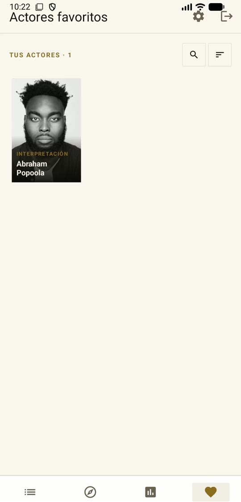<br><sub><b>Actores favoritos</b></sub></td><td align="center">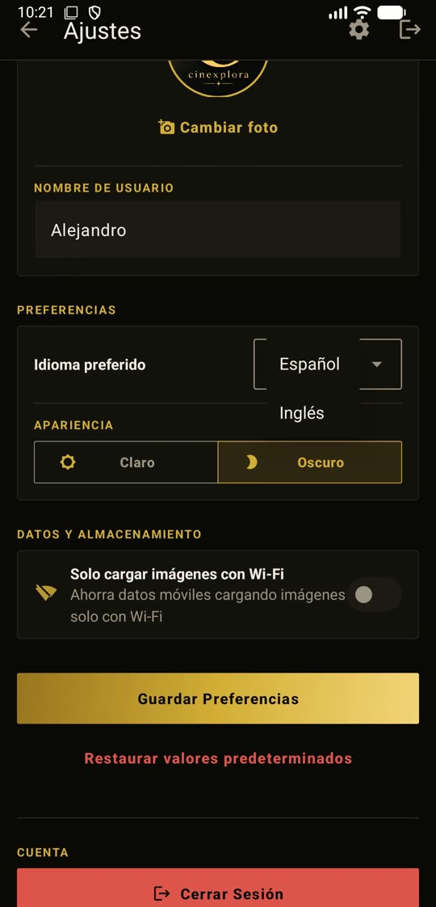<br><sub><b>Ajustes: idioma y tema</b></sub></td></tr>
</table>

## Arquitectura y stack

Patrón **MVVM** (ViewModel + LiveData) con repositorios que abstraen el origen de los datos.

| Capa | Tecnologías |
|---|---|
| Lenguaje y plataforma | Java · Android SDK (API 24 – 36) · Gradle con Kotlin DSL |
| UI | Material Design 3 · Navigation Component · ViewPager2 · layouts para vertical (`layout`) y horizontal (`layout-land`) |
| Red | Retrofit 2.9 · OkHttp 4.12 · Gson · Glide 4.15 (imágenes) |
| Datos y servicios | **Firebase Authentication** (email y Google) · **Cloud Firestore** (perfiles, seguimiento, favoritos y pendientes) · **Supabase Storage** (fotos de perfil y de seguimiento) · **TMDB API v3** (películas y series) |

## Estructura
```
CineXplora/
├── app/src/main/
│   ├── java/es/iesagora/cinexplora/
│   │   ├── view/              # Fragments y Activities (auth, explore, details, watchlist, tracking, favorites)
│   │   ├── controller/        # repository/ (Firebase, TMDB, Supabase) y viewmodel/ (MVVM)
│   │   ├── model/             # request/, response/ y states/ (Resource, AuthState)
│   │   ├── network/           # Retrofit, interceptores y clientes
│   │   ├── recyclerview/      # Adapters de listas
│   │   └── utils/
│   └── res/                   # layout/, layout-land/, navigation/, values/ (en) y values-es/
├── app/src/test · androidTest # Tests unitarios e instrumentados
└── docs/screenshots/          # Capturas de pantalla
```

## Ejecución
Requisitos: Android Studio reciente, JDK 17+, Android SDK (API 24 mínimo), un proyecto de Firebase con Authentication y Firestore habilitados y una clave de la API de TMDB.

1. Abre el proyecto en **Android Studio** y deja que sincronice Gradle.
2. Configura las claves en `local.properties` (TMDB y Supabase) y añade el archivo `google-services.json` de Firebase.
3. Conecta un dispositivo o inicia un emulador y pulsa **Run**, o desde la terminal:

```bash
./gradlew installDebug
```

---
<p align="center">Proyecto personal de <a href="https://github.com/Alejandro-Plata">Alejandro Plata Cortés</a> · Datos de cine: TMDB</p>
